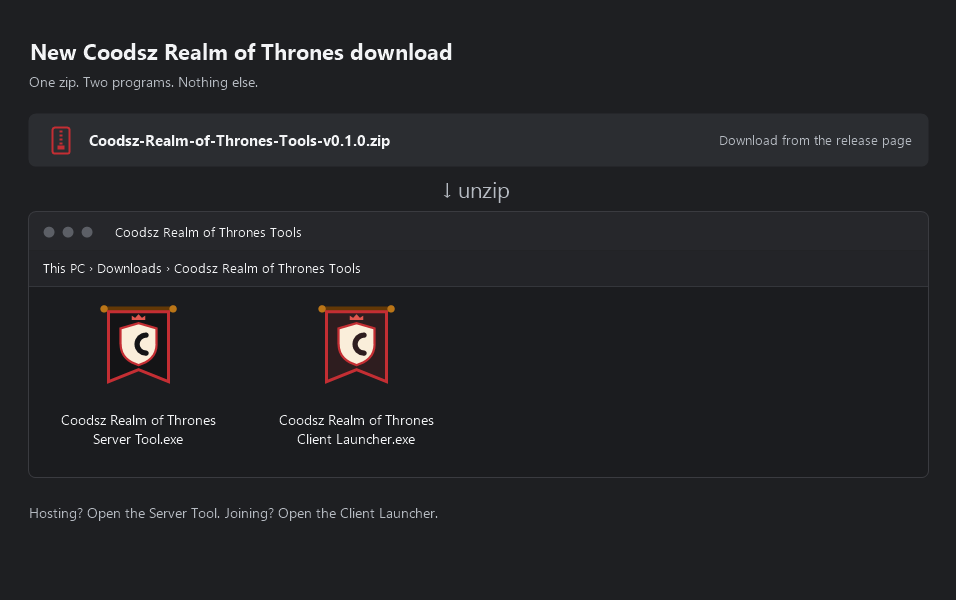

# Coodsz Realm of Thrones

Tools that make hosting and playing Realm of Thrones in Bannerlord Coop easier. Made by Coodsz.

- **Coodsz Realm of Thrones Server Tool** runs a Realm of Thrones Coop server for you.
- **Coodsz Realm of Thrones Client Launcher** gets your game ready and joins the server.
- **Realm of Thrones Coop Compat** is the patch that makes Realm of Thrones work in Coop. It comes with both tools.

The tools never contain Realm of Thrones. You get it yourself from [Nexus Mods](https://www.nexusmods.com/mountandblade2bannerlord/mods/2907).

Made for Realm of Thrones 8.1.2, Bannerlord 1.4.8 and Coop 0.1.8 (the Realm of Thrones build the tools carry). You need the War Sails DLC too. Windows only.

## Download

Get the latest Coodsz-Realm-of-Thrones-Tools zip from [Releases](https://github.com/Coodsz/Coodsz-RealmOfThrones/releases/latest). It holds both programs. Unzip it before you open a tool. The instructions file in the release explains every step.

## Which mods work

See [MODS.md](MODS.md) for the mod list. It is empty for now, and the tools do not read it yet.

## Report a mod

Use the [report form](https://github.com/Coodsz/Coodsz-RealmOfThrones/issues/new?template=mod-compat.yml) and say whether a mod works or is broken. Player reports show in the Players column of the list. Coodsz sets the status.

## Known issues

- Sieges are still being tested. In some tests the siege menu showed only **Leave**, with no way to start the assault, and one big battle at Casterly Rock stopped near the end.
- In a Coop game the White Walker start is not offered in character creation.
- Enlisting in a lord's party, changing the storyline wars and sending ravens are off in Coop. The game says so when you try.
- A few Realm of Thrones details, like militia sizes, may show the old state on a player's PC for a while.
- Sending logs from the tools is not set up yet for Realm of Thrones.

## Credits

- Bannerlord Coop by the Bannerlord Coop team.
- Code from CoopKeep by aderimo (MIT) is adapted for the report form.
- Tools and compat patch made by Coodsz.
